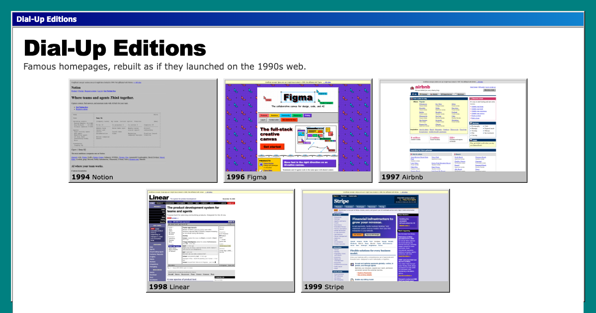
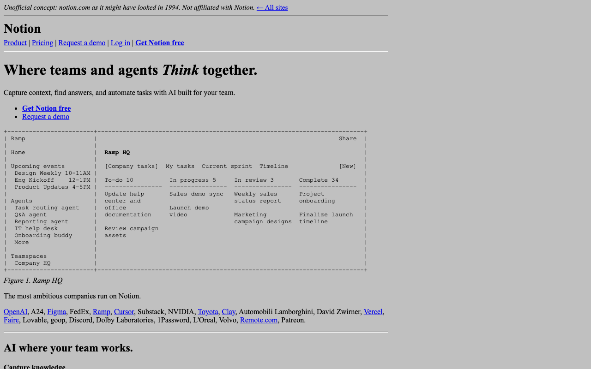
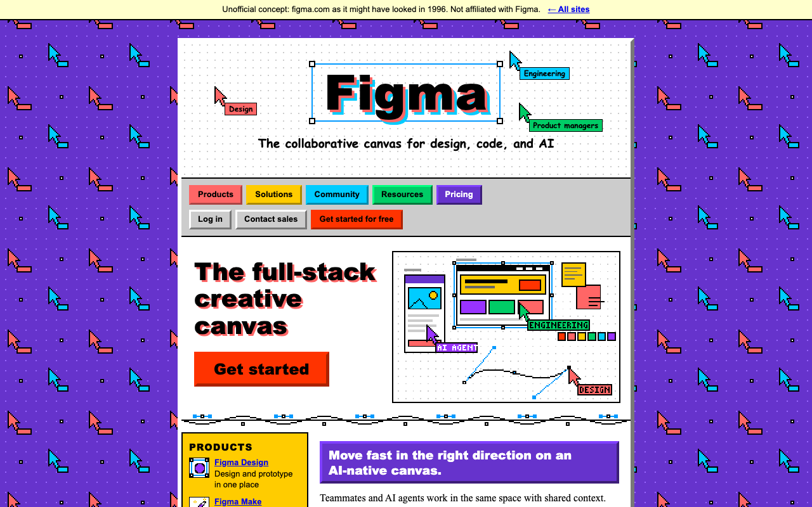
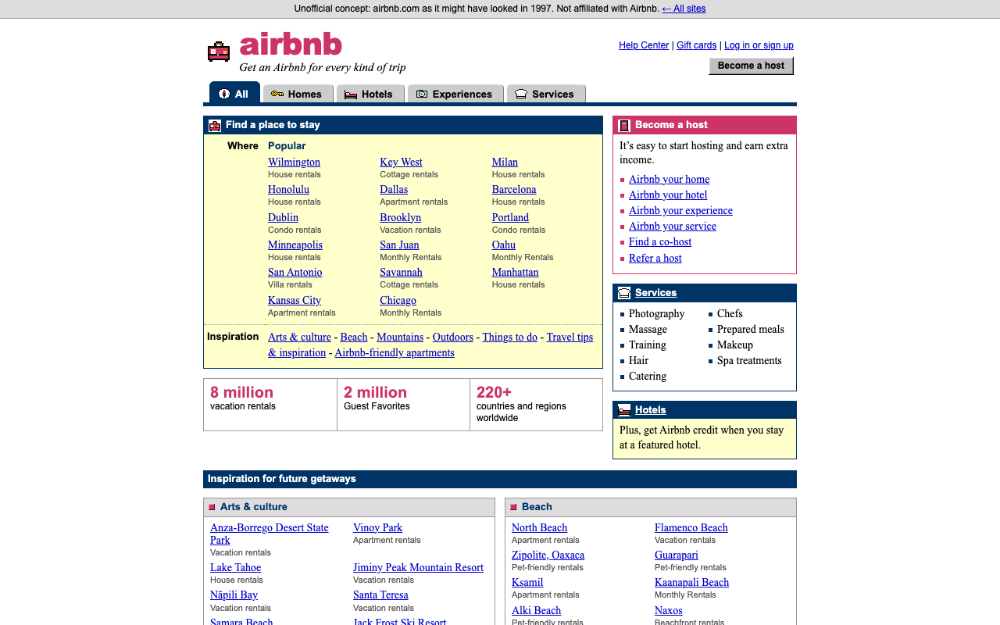
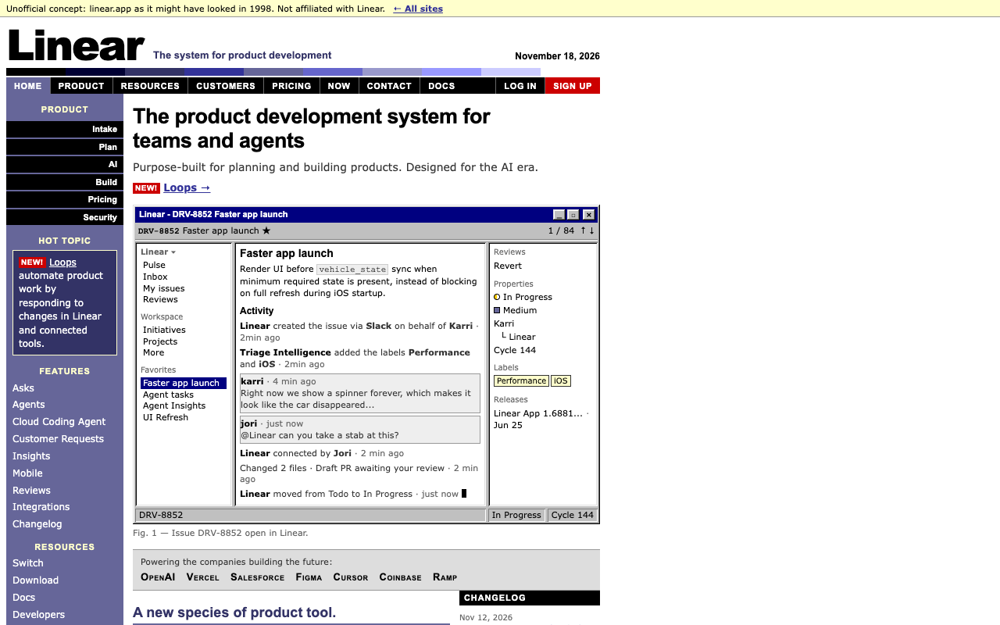
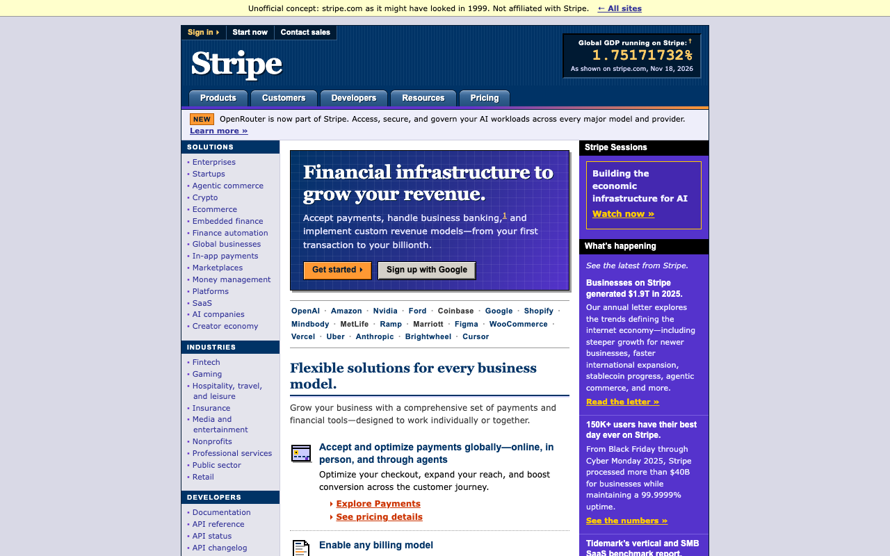

# retro-web-90s

A Claude Code skill that rebuilds your website as if it launched in the 90s.

Give it a URL. It reads the real site, picks a year between 1991 and 1999, pulls up actual sites from that year on the Wayback Machine, then rebuilds your pages in plain HTML and CSS. Your copy and links stay as they are. You won't get fake visitor counters or a neon starfield.



See them live: **[90s.pylondev.com](https://90s.pylondev.com)**

| | |
|---|---|
| **Notion, 1994**  | **Figma, 1996**  |
| **Airbnb, 1997**  | **Linear, 1998**  |
| **Stripe, 1999**  | |

These are unofficial fan redesigns, not affiliated with any of those companies.

## Install

```
git clone https://github.com/alishansnsn/retro-web-90s ~/.claude/skills/retro-web-90s
```

For Codex, clone it into `.agents/skills/retro-web-90s` inside your project.

## Use

```
/retro-web-90s https://yoursite.com
```

Or ask: "make my site look like it launched in 1997."

MIT
